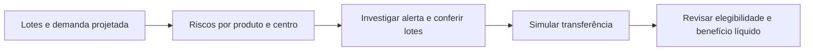

# Radar de Estoque e Validade

Quais lotes precisam de atenção nesta semana? Onde vale simular uma transferência antes de decidir? O Radar reúne estoque por lote, projeção de demanda e validade para priorizar riscos e comparar o impacto econômico de uma transferência.

[**Abrir o painel semanal**](https://radar-estoque-validade-pifpaf.yhenri-ux.chatgpt.site/#/painel) · [Central de alertas](https://radar-estoque-validade-pifpaf.yhenri-ux.chatgpt.site/#/alertas) · [Simulador](https://radar-estoque-validade-pifpaf.yhenri-ux.chatgpt.site/#/simulador)

| Vencimento em risco | Ruptura projetada | Centros com risco | Registros válidos |
| ---: | ---: | ---: | ---: |
| 410.188 unidades | 32.134 unidades | 9 de 9 | 99,95% |

Recorte padrão de 14 dias, com todos os produtos e centros. A semana 47 de 2026 é a referência fixa. O case é independente e usa dados, centros e parâmetros operacionais hipotéticos. Os indicadores descrevem a demonstração.

## Uma decisão em três minutos

1. No **Painel semanal**, compare vencimento e ruptura por região e selecione um centro.
2. Na **Central de alertas**, use **Investigar** para levar o produto e o centro ao simulador. Em **Lotes e validade**, abra **Detalhes** para conferir validade, reservas e saldo disponível.
3. No **Simulador**, ajuste origem, destino, quantidade e custos. Compare o benefício líquido com os limites de disponibilidade, necessidade e validade na chegada.

O cenário é calculado no navegador. A demanda vem de uma fórmula determinística e a faixa de ±17% é heurística. O resultado do simulador apoia uma decisão humana. O rodapé também dá acesso à jornada anterior, com registro e acompanhamento locais em um cenário separado.

## Documentação técnica

| Página | Conteúdo |
| --- | --- |
| [Guia da demonstração](docs/index.md) | Sete telas, filtros, navegação e roteiro |
| [Arquitetura](docs/arquitetura.md) | Componentes publicados e fronteiras de uma implantação |
| [Dados e indicadores](docs/dados.md) | Contratos, chaves, qualidade e cálculos |
| [Projeções e simulador](docs/modelos.md) | Consumo por validade, elegibilidade e fórmula econômica |
| [Visualizações](docs/visualizacoes-interativas.md) | Interações de gráficos, tabelas e exportação |
| [Decisões arquiteturais](docs/decisoes-arquiteturais.md) | Motivos e limites das escolhas do protótipo |
| [Evidências](docs/evidencias.md) | Versão publicada, verificações e roteiro de reprodução |
| [Evolução proposta](docs/maturity-roadmap.md) | Condições para um piloto com dados autorizados |

Versão publicada verificada **45**, revisão do Sites `bef04f2`. Este repositório reúne a documentação do case.
