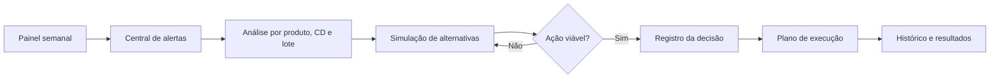
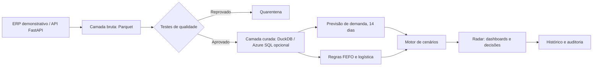

# Radar de Estoque e Validade

> **Antecipe perdas, evite rupturas e apoie decisões de abastecimento com dados e IA.**

O Radar é um **produto demonstrativo de decisão para operações de alimentos congelados**. Combina informações de lotes, datas de validade, demanda e restrições logísticas para comparar ações de **transferência entre centros de distribuição, reposição e intervenções comerciais**.

**[Explorar a aplicação](https://radar-estoque-validade-pifpaf.yhenri-ux.chatgpt.site/)** · [Documentação](docs/index.md) · [Jornada do gestor](docs/produto/jornada.md) · [Arquitetura](docs/arquitetura.md) · [Reproduzir](docs/reproducao.md)

> **Transparência:** este repositório documenta uma demonstração independente com **dados sintéticos**. Os cenários e benefícios financeiros são **estimativas de simulação**, não economias realizadas pela Pif Paf Alimentos. O projeto não representa implantação, patrocínio nem endosso da empresa. **Em 17/11/2026, o repositório estava inicialmente vazio**; a documentação abaixo registra o **blueprint fornecido**, a **interface pública observável** e os **componentes ainda sujeitos a validação**. O código-fonte da aplicação publicada não foi disponibilizado aqui para auditoria.

## A decisão que importa

Um lote do **pão de queijo de 1 kg** tem **1.200 unidades no CD A**. Destas, **400 vencem em até 14 dias** e **180 unidades são estimadas como sobra**. Enquanto isso, o CD B apresenta risco de ruptura. O Radar permite investigar as evidências, comparar a transferência com outras alternativas e registrar uma decisão fundamentada. **As 180 unidades não constituem uma ordem automática de transferência**: o cálculo precisa respeitar FEFO, lead time, validade mínima, custos, disponibilidade e demanda do destino.

## Visão executiva

| Dimensão | Valor para a decisão | Como validar |
| --- | --- | --- |
| Risco de vencimento | Priorizar produtos que podem perder valor | Lote, validade, cobertura e demanda |
| Risco de ruptura | Avaliar capacidade de atender a demanda | Estoque disponível, previsão e lead time |
| Transferência entre CDs | Comparar perdas evitáveis e custo logístico | Cenários condicionados a restrições |
| Previsão de demanda | Antecipar comportamento nos próximos 14 dias | Baseline, erro temporal, versão do modelo |
| Governança e qualidade | Evitar decisão sobre registros inconsistentes | Regras, trilha de auditoria e atualização |
| Benefício econômico | Estimar resultado líquido de cada ação | Fórmulas, premissas e análise de sensibilidade |

## Jornada demonstrativa

O produto foi especificado com **19 telas (S00 a S18)** e **cinco jornadas** para gestores, analistas, engenharia de dados/IA e diretoria. Consulte [jornada e inventário de telas](docs/produto/jornada.md).

## Arquitetura de referência

**Importante:** o diagrama descreve a **arquitetura proposta no blueprint**, e **não comprova o deploy** de FastAPI, Azure, DuckDB ou scikit-learn na aplicação publicada. Consulte a [matriz de evidências](docs/evidencias.md).

## Documentação técnica

| Trilha | Conteúdo |
| --- | --- |
| [Visão geral](docs/index.md) | Objetivo, limites, públicos e organização |
| [Arquitetura e ADRs](docs/arquitetura.md) | C4, serviços, fluxos e decisões arquiteturais |
| [Dados e métricas](docs/dados.md) | Modelo conceitual, granularidade, validações e KPIs |
| [Modelo e recomendações](docs/modelos.md) | Baseline, backtesting, MLflow e regras |
| [Jornadas e telas](docs/produto/jornada.md) | Fluxos, perfis, rotas e cenários de erro |
| [Reprodução](docs/reproducao.md) | Pré-requisitos, roteiro de reprodução e verificação |
| [Segurança e governança](docs/governanca.md) | LGPD, permissões, rastreabilidade e transparência |
| [Evidências e limitações](docs/evidencias.md) | O que foi observado, especificado e ainda precisa ser testado |
| [Roteiro de demonstração](docs/demo.md) | Apresentação de três minutos |
| [Guia para Codex](AGENTS.md) | Inspeção do projeto, entrega documental e critérios de aceite |

## Recursos visuais

A documentação usa **Mermaid** diretamente no GitHub e adota arquivos-fonte versionáveis para **D2** e **DBML**. Exportações **SVG/PNG**, gráficos **Plotly**, **Storybook**, **Swagger/ReDoc**, **MkDocs Material** e **GitHub Pages** serão gerados ou conectados **somente após verificação da implementação correspondente**. Veja [visualizações e rastreabilidade](docs/visuais.md).

## Reprodução e participação

**Situação atual:** este repositório foi iniciado para a documentação; ainda não contém o código-fonte necessário para uma execução local integral. As etapas planejadas estão descritas em [reprodução](docs/reproducao.md), sem inventar comandos funcionais.

As contribuições devem preservar a proveniência das métricas, referenciar o código e manter a rastreabilidade entre requisitos, testes e documentação.

**Uso de marca:** a identidade visual da Pif Paf Alimentos é utilizada como referência de estudo; logotipos e demais ativos corporativos pertencem a seus respectivos titulares.