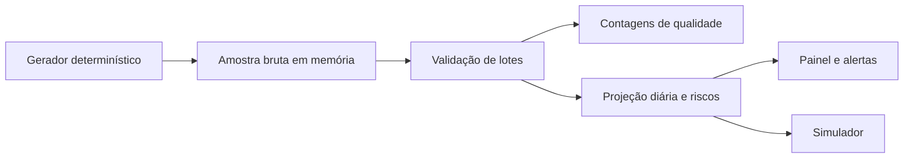

# Arquitetura da demonstração publicada

O Sites serve um HTML com CSS e JavaScript. O navegador gera produtos, lotes e vendas, valida a amostra de lotes brutos, calcula os recortes e desenha as visualizações. A interface principal funciona com dados em memória. A semana e a atualização de referência são fixas.

A tela de pipelines ilustra extração, Bronze, Silver, Gold e consumo. A geração, as verificações de duplicidade, validade e saldo e as agregações rodam em JavaScript. Persistência em camadas, ingestão incremental externa, reprocessamento orquestrado e serviços como Azure, FastAPI, DuckDB e MLflow são referências de arquitetura fora do fluxo publicado. A interface anterior permanece acessível separadamente pelo rodapé.
