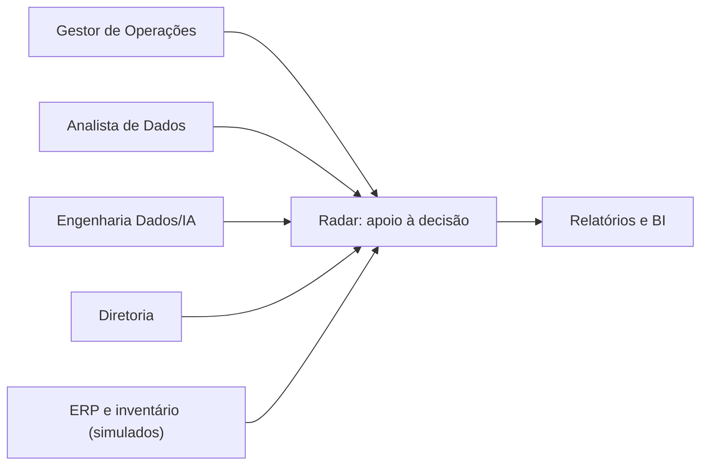
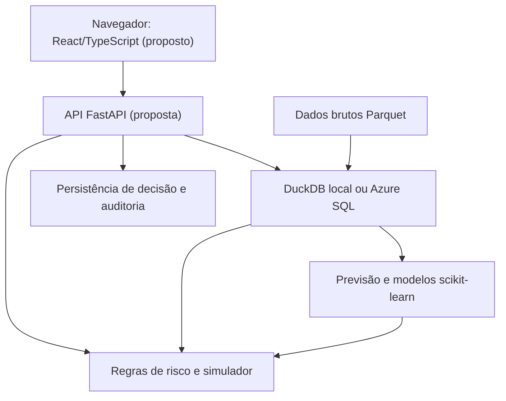
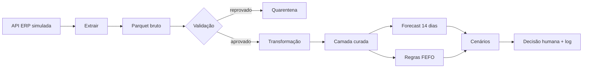

# Arquitetura de referência

**Estado:** proposta técnica do blueprint, **não auditada no código da aplicação publicada**. O repositório estava vazio antes da documentação. Toda tecnologia nesta página é proposta, salvo quando expressamente indicada como interface observada.

## Objetivos arquiteturais

1. Reunir dados de produto, lote, CD, demanda e custos.
2. Validar completude e consistência antes de publicar indicadores.
3. Prever demanda por produto e CD em 14 dias, comparando baseline e modelo.
4. Gerar alertas com regras determinísticas e proveniência.
5. Simular transferências, reposições e ações comerciais sem movimentação real.
6. Registrar justificativas, versões e trilha de auditoria.
7. Possibilitar execução local sem dependência paga.

## C4: contexto

## C4: contêineres previstos

Arquivos diagramáveis: [D2](../diagrams/architecture.d2). Exportar o mesmo modelo com legenda e semântica de dados para SVG; preservar esta origem textual.

## Fluxo de dados

## Alternativas técnicas e trade-offs

| Decisão | Padrão local proposto | Evolução cloud possível | Critério de escolha |
|---|---|---|---|
| Raw | Parquet e filesystem | Azure Blob | Rastreabilidade, custo e escala |
| Curado/analítico | DuckDB | Azure SQL | Reprodutibilidade e volume |
| API | FastAPI/OpenAPI | Serviço gerenciado | Contratos e observabilidade |
| Previsão | Baseline e scikit-learn | Pipeline gerenciado | Performance comprovada |
| Tracking | Logs versionados e MLflow | Serviço centralizado | Auditoria, custo e manutenção |
| Visualização | Aplicação web nativa | Power BI/Tableau | Acesso e caso de uso |

Não declarar que Azure, Power BI, Tableau ou MLflow estejam efetivamente implantados sem evidência verificável no repositório.

## ADR-001: interface demonstrativa com arquitetura reproduzível

**Decisão proposta:** privilegiar execução local e seed determinística. **Consequência:** menor custo para avaliadores, com limitações de escala e realismo. **Gatilho de mudança:** piloto com fontes corporativas autorizadas e requisitos de segurança operacionais.

## ADR-002: regras de negócio separadas do modelo

**Decisão proposta:** o modelo prevê demanda; regras explícitas determinam viabilidade de alternativas. **Razão:** permite auditar FEFO, validade mínima, lead time e custos. **Risco:** parâmetros incorretos podem invalidar decisões; exigir versionamento e revisão humana.

## ADR-003: registro imutável da decisão

**Decisão proposta:** cada decisão retém contexto do produto/CD/lote, período, entradas, modelo, premissas, autor lógico e momento da avaliação. **Razão:** uma mudança posterior no inventário não pode reescrever a justificativa histórica.

## Rotas e contratos

As 19 telas estão no [inventário de produto](produto/jornada.md). O blueprint propõe endpoints versionados `/api/v1`, mas **a especificação OpenAPI real deve ser gerada a partir da aplicação**, após publicação do backend. Não criar endpoints fictícios como se estivessem ativos.
