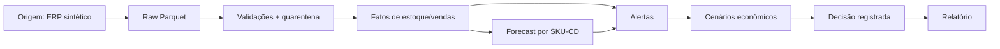

# Modelo de dados, qualidade e indicadores

**Natureza:** especificação conceitual baseada no blueprint; entidades, chaves e campos devem ser confrontados com o código quando publicado.

## Recorte de referência

20 produtos, 2 centros de distribuição, 12 meses de histórico, periodicidade de decisão semanal e previsão de demanda de 14 dias. O caso âncora é pão de queijo 1 kg no CD A: 1.200 unidades, das quais 400 vencem em até 14 dias; sobra estimada de 180 unidades. O CD B apresenta risco de ruptura a ser calculado.

## Modelo lógico de referência

Use [DBML versionável](../diagrams/modelo-dados.dbml) para gerar o diagrama ER e manter os nomes em sincronia com os esquemas reais. Entidades mínimas propostas:

| Entidade | Grão | Papel |
|---|---|---|
| `product` | SKU | Produto, família, unidade e características |
| `distribution_center` | CD | Origem e destino |
| `inventory_lot` | SKU × CD × lote | Saldo, bloqueios, reservas, validade |
| `sale_daily` | data × SKU × CD | Demanda realizada |
| `forecast` | data de referência × horizonte × SKU × CD × versão | Demanda prevista e intervalo |
| `transfer_route` | origem × destino | Prazo, custo e restrições |
| `risk_alert` | execução × SKU × CD × tipo | Evidência de risco e severidade |
| `simulation` | cenário/execução | Entradas, restrições e resultados |
| `decision` | decisão | Registro humano e justificativa |
| `quality_check` | execução × teste × tabela | Resultado e motivo |

## Qualidade e contratos

- **Unicidade:** não pode existir duplicação de chave `CD + SKU + lote` no mesmo snapshot.
- **Validade:** lotes devem ter data válida e coerente com o tipo de produto; lote vencido é inelegível para consumo/transferência.
- **Estoque disponível:** `max(0, saldo_fisico - reservado - bloqueado)`; registros negativos ou inconsistentes vão à quarentena.
- **Integridade:** SKU e CD precisam existir nas dimensões.
- **Atualidade:** toda extração exibe `extracted_at` e estado do processamento.
- **Identificação:** dados sintéticos não devem incluir dados pessoais de clientes.
- **Temporalidade:** usar UTC no armazenamento e exibição adequada em `America/Sao_Paulo`.

## KPI: unidades sob risco

A soma de unidades com risco precisa ser estimada com base em validade, demanda de lotes elegíveis, política FEFO e horizonte declarado. **Não interpretar toda unidade que vence em 14 dias como perda certa.**

## KPI: risco de ruptura

Projeção negativa de disponibilidade futura, conforme demanda esperada, entradas confirmadas e lead time. Sempre separar falta estimada em unidades de quantidade de SKUs expostos.

## KPI: potencial econômico

Definições de referência:

```text
valor_em_risco = quantidade_estimada_em_risco × valor_unitário_escolhido
custo_transferencia = quantidade_transferida × frete_unitário + custos_fixos_aplicáveis
beneficio_bruto_projetado = perda_evitel_estimativa + margem_recuperada_estimativa
beneficio_liquido_projetado = beneficio_bruto_projetado - custo_transferencia - outros_custos
```

A definição de **valor_unitário** (custo contábil, preço de venda ou margem) deve ser explícita. Evite somar perda evitada e margem recuperada quando isso causar dupla contagem. Sem custo, demanda ou prazo confiável, declarar o benefício líquido como indisponível.

## Linhagem



## Reprodução e governança

A geração deverá fixar seed, faixa de datas, versão de schema e controle de qualidade. Versionar dados pequenos de exemplo ou script gerador sem comprometer limites do Git. Consultar [guia de reprodução](reproducao.md) e [governança](governanca.md).
