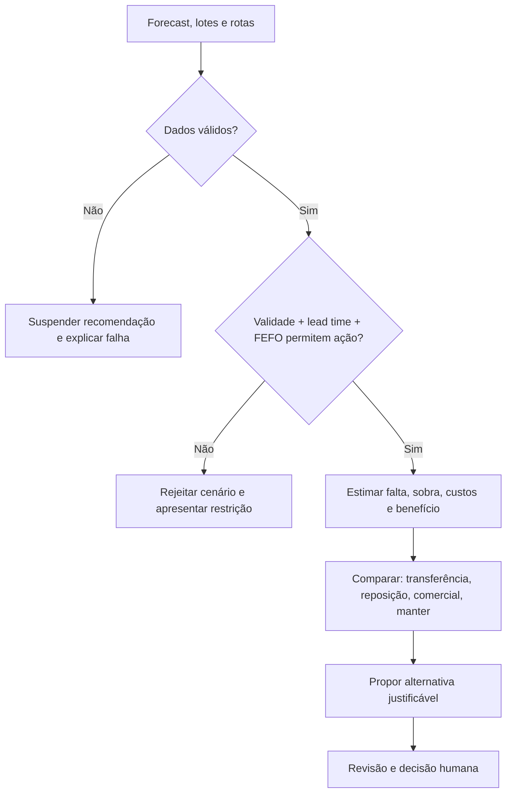

# Inteligência artificial, previsão e recomendações

**Status:** desenho de referência. O código do pipeline, artefatos de treino e experimentos ainda precisam ser incorporados ao repositório para validação independente.

## Pergunta de previsão

Qual a demanda esperada para cada combinação de SKU e CD nos próximos **14 dias**? A previsão alimenta a estimativa de consumo dos lotes, respeitando datas de validade e regras logísticas.

## Baseline e candidato

- **Baseline:** média móvel e, se houver evidência de sazonalidade, baseline sazonal.
- **Candidato:** regressão supervisionada em scikit-learn, utilizando defasagens de vendas, dia da semana, mês, sazonalidade e outras variáveis disponíveis no histórico.
- **Seleção:** validação temporal rolling-origin, sem embaralhamento entre treino e teste.
- **Granularidade:** avaliação geral e por SKU/CD; produtos raros exigem cautela.
- **Risco:** leakage de variáveis futuras e amostra reduzida.

## Métricas mínimas

| Métrica | Uso | Cuidado |
|---|---|---|
| MAE | Erro médio em unidades | Sensível à escala |
| WAPE | Erro relativo ponderado | Tratar denominador zero |
| Bias | Superestimação/subestimação sistemática | Afeta risco de ruptura e perdas |
| Intervalo da previsão | Apoiar análise de incerteza | Método de estimação precisa ser documentado |
| Baseline delta | Evidenciar ganho real do candidato | Evitar declarar melhora sem backtest |

A documentação final deve apresentar dataset, recortes de treino/teste, hiperparâmetros, versões, gráficos e tabela com valores efetivamente calculados. **Nenhuma métrica de desempenho é comprovada apenas pelo blueprint.**

## Regras de recomendação

## MLOps de referência

Experimentos versionados, rastreabilidade de dataset, pipeline, parâmetros e métricas em MLflow (se instalado). Testes automáticos contra regressão, deriva de erro e degradação de qualidade dos dados. Alertas devem mostrar data e versão do modelo; em caso de falha, explicitar fallback de baseline.

## Visualizações sugeridas

- Série histórica × previsão e intervalo.
- Erro MAE por SKU e CD.
- Scatter de previsão × realizado.
- Tendência de bias por janela temporal.
- Comparativo baseline × candidato.

Gerar gráficos com Plotly a partir de artefatos de avaliação reais; exportar SVG/PNG para README e HTML para GitHub Pages. Não produzir gráficos com números inventados.
